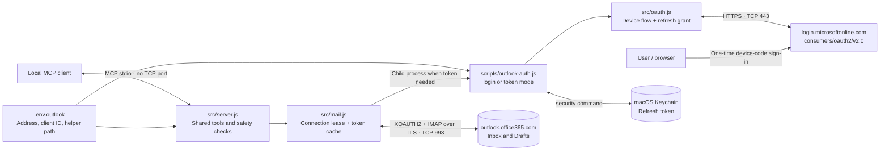
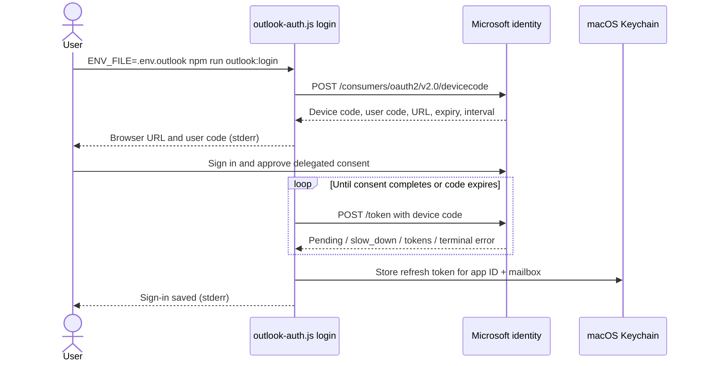

# Outlook.com design and architecture

Outlook.com support adds OAuth credentials to the existing IMAP connection manager. The same list, search, read, reply-draft, Junk-move, unsubscribe, sanitization, and safety-hook implementations serve Yahoo and Outlook. Each configured MCP entry owns one mailbox connection; running Yahoo and Outlook together requires two server processes with separate environment files.

This design targets personal Outlook.com, Hotmail, and Live mailboxes. The built-in sign-in helper uses macOS Keychain. Microsoft 365 work/school authorities and external token helpers are configurable but have not been live-validated.

## Components and boundaries



| Component | Responsibility |
|---|---|
| `src/server.js` | Loads configuration, validates startup, exposes MCP tools, applies shared mailbox and content policies |
| `src/mail.js` | Chooses host/authentication, runs the token helper, validates token JSON, caches access tokens, constructs XOAUTH2, manages one serialized IMAP connection |
| `src/oauth.js` | Calls Microsoft device-code and token endpoints; handles polling, denial, expiry, refresh and refresh-token rotation through injected storage callbacks |
| `scripts/outlook-auth.js` | Loads the selected environment file, reads/writes Keychain, prints browser instructions in login mode and token JSON in token mode |
| `test/oauth.test.js` | Offline tests for OAuth flow, storage callbacks, errors, cache, configuration and Outlook's IMAP capability behavior |

The helper's stdout in token mode is a private credential channel to the parent process, not an MCP response. Login instructions and diagnostic errors use stderr. Access-token JSON must never be forwarded to the AI client or copied into logs.

## One-time interactive sign-in

Prerequisites: IMAP enabled in Outlook.com; a registered public-client application supporting personal Microsoft accounts; public client flows enabled; mailbox address and application ID set in `.env.outlook`.



The helper requests `offline_access` and `https://outlook.office.com/IMAP.AccessAsUser.All`. For personal accounts it requests delegated consent at sign-in; manual permission selection in the portal is not a prerequisite. The application ID is public configuration. No client secret, redirect listener, Graph permission, or SMTP permission is used. Microsoft documents the [IMAP OAuth scope and XOAUTH2 format](https://learn.microsoft.com/en-us/exchange/client-developer/legacy-protocols/how-to-authenticate-an-imap-pop-smtp-application-by-using-oauth), [device flow](https://learn.microsoft.com/en-us/entra/identity-platform/v2-oauth2-device-code), and [dynamic delegated consent](https://learn.microsoft.com/en-us/entra/identity-platform/permissions-consent-overview).

Polling follows the supplied interval, adds five seconds for `slow_down`, and stops on denial or expiry. OAuth network requests have a 30-second timeout. Interactive login runs outside the MCP server and is initiated explicitly by the user.

The browser must sign in to the mailbox configured as `MAIL_ADDRESS`. The helper does not decode Microsoft access tokens or independently verify the signed-in account. A mismatched account is expected to fail IMAP authentication rather than provide access to another mailbox.

## Token refresh and mailbox connection

```mermaid
sequenceDiagram
    participant Client as MCP client
    participant Server as Shared tools / MailClient
    participant Helper as outlook-auth.js token
    participant Keychain as macOS Keychain
    participant Microsoft as Microsoft identity
    participant Outlook as Outlook IMAP

    Client->>Server: list_emails / search_emails / read_email
    alt Existing authenticated IMAP connection
        Server->>Outlook: Reuse connection under exclusive lease
    else A new IMAP connection is needed
        alt Access-token cache expired or empty
            Server->>Helper: Run MAIL_OAUTH_TOKEN_COMMAND
            Helper->>Keychain: Read refresh token
            Helper->>Microsoft: POST /token (refresh_token grant)
            Microsoft-->>Helper: Access token, expires_in, optional rotated refresh token
            Helper->>Keychain: Save rotated refresh token when supplied
            Helper-->>Server: JSON access_token + expires_in on stdout
            Server->>Server: Cache until expiry minus 60 seconds
        end
        Server->>Outlook: TLS 1.2+ connection, certificate validation
        Server->>Outlook: AUTHENTICATE XOAUTH2
        Outlook-->>Server: Authenticated
    end
    Server->>Outlook: EXAMINE folder, UID SEARCH, BODY.PEEK FETCH
    Outlook-->>Server: Message metadata / raw MIME
    Server->>Server: Parse, sanitize, safety checks, untrusted wrapping
    Server-->>Client: MCP result; no OAuth credentials
```

Refresh occurs when a new connection needs credentials and the in-memory token is no longer usable. It is not a scheduled background task, and token expiry does not cause the server to close an already authenticated IMAP connection. The existing idle timeout closes the connection after five minutes without use by default; the next call reconnects.

The helper contract is JSON with a nonempty `access_token` and a positive finite `expires_in` measured in seconds remaining. Microsoft tokens are treated as opaque strings. The server does not parse them as JWTs. The token command has a 120-second timeout so credential-store prompts have time to complete.

Authentication failures clear both credential caches for the next connection attempt. The server does not automatically launch browser sign-in or silently retry tool calls. Revoked or expired refresh tokens require another explicit `outlook:login` run. Command and OAuth response errors are sanitized so their bodies cannot disclose tokens.

## Keychain storage and copies

The service name is `mail-brief-mcp-outlook-<OUTLOOK_CLIENT_ID>` and the account is `MAIL_ADDRESS`. The helper uses `security find-generic-password` to read and `security add-generic-password -U` to save or replace refresh tokens. The entry trusts only `/usr/bin/security`, the app that created it. Microsoft can rotate the refresh token on each refresh, so a "trust no app" entry (`-T ""`) would bring up an approval prompt roughly every hour.

Only the refresh token is persisted, in Keychain. Access tokens remain in process memory. No credentials are stored in project files; `.env.outlook` contains address, client ID, and commands. Like the password integration, configured helper commands are trusted local code and must be controlled by the user. The helper passes the refresh token to `security -i` on standard input, so it never appears in the process list; it is never printed in command errors or application logs.

Project copies on one Mac share the Keychain entry when client ID and address match. The MCP `args` and token-helper command must point to the chosen copy. Another computer needs its own sign-in. Separate MCP processes have separate access-token caches and may each refresh the shared entry; there is no cross-process refresh lock. Normal operation should use one Outlook server entry per mailbox.

## Outlook LOGINDISABLED compatibility

The installed `imap` 0.8 library checks `LOGINDISABLED` before trying XOAUTH2. Outlook advertises that password LOGIN is disabled while still advertising OAuth, which caused the first live connection attempt to fail before authentication.

`enableOAuthLogin()` in `src/mail.js` wraps that connection's capability check. It suppresses the `LOGINDISABLED` result only while the connection is in its pre-authentication `connected` state, the actual socket is encrypted, and the server advertises `AUTH=XOAUTH2`. Every other capability check retains the library's result. The wrapper is installed only when OAuth credentials are supplied, and no password is supplied in OAuth mode.

This adapts the library's authentication decision without disabling TLS verification, adding password fallback, or modifying dependency files. It depends on the library's `_sock` field, so a future library upgrade must recheck this behavior. An offline regression test covers encrypted and unencrypted sockets, lack of OAuth support, and authenticated state.

## Draft design

Outlook uses the existing draft pipeline: derive recipients and threading from the original message, run safety hooks, build MIME, detect the Drafts folder, then IMAP APPEND with draft flags and the `X-Mail-Brief-Draft` marker. Draft updates require that marker and return a new UID. A prior version is removed with UID-specific EXPUNGE only when UIDPLUS is available; otherwise it remains for the user to remove safely.

`READ_ONLY=true` removes draft, Junk-move, and unsubscribe action tools and blocks calls to them. Unsubscribe-header inspection remains available. This is an application restriction: the Microsoft IMAP consent itself permits broader mailbox operations. The server has no send tool and establishes no SMTP connection, regardless of consent scope or read-only mode.

## Validation and remaining work

| Area | Evidence / status |
|---|---|
| Yahoo regression and shared tool behavior | Existing offline suite passes; Yahoo previously live-tested |
| OAuth device polling, pending/slow-down, denial and expiry | Offline coverage |
| Refresh grant, rotated token persistence, sanitized errors | Offline coverage; successful live refresh on a personal Outlook.com account |
| Token caching, expiry checks, XOAUTH2 and configuration | Offline coverage |
| LOGINDISABLED adapter | Offline regression test and successful live Outlook login |
| Personal Outlook listing and reading | Live-tested: three messages listed, one read, read status unchanged |
| Outlook live search, reply drafts and updates | Pending live validation |
| Microsoft 365 work/school accounts | Configurable authority; pending live validation and tenant policies |
| Windows/Linux OAuth helper | User-supplied helper only; included Keychain helper is macOS-specific |

## Junk and unsubscribe extension

The existing Outlook IMAP OAuth scope also authorizes native MOVE, so no new Microsoft permission or sign-in is required for Junk movement. The server discovers Outlook's existing Junk folder, validates selected UIDs, requires advertised MOVE support, and performs a user-requested UID MOVE. This changes location only; it does not submit Microsoft's spam feedback or block future mail.

Unsubscribe is independent of Microsoft OAuth. The server inspects the message's standard list headers and, after explicit user authorization, POSTs the one-click form body to the exact public HTTPS endpoint supplied by the message. Mailbox tokens and credentials are never sent to that endpoint. Web forms and email-based requests remain manual; the server does not send mail. DNS validation/pinning and redirect refusal constrain sender-supplied URLs. DKIM is not independently checked, so requests are user-directed rather than automatic sender-triggered actions.

These extensions have offline coverage but have not changed any live Outlook messages or subscriptions during development. See the [shared cleanup design](ARCHITECTURE.md#junk-and-unsubscribe-design) for guards and request semantics.

See [README.md](README.md) for setup, MCP configuration, testing and recovery commands. The architecture does not add an HTTP MCP transport, a hosted deployment, or multi-user credential storage.
