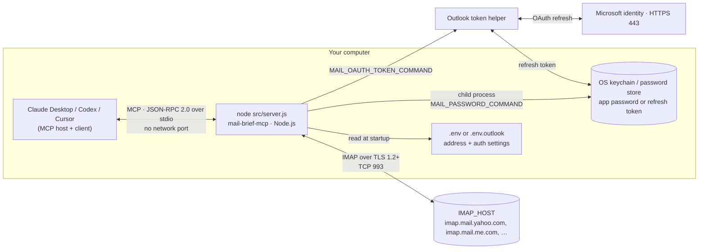

# mail-brief-mcp

A small, least-privilege MCP server for email. It helps your AI assistant **summarize what arrived** and **draft replies for review**. Optional cleanup tools, off by default, **move selected messages to Junk** and **unsubscribe from supported mailing lists at your request**.

Works with any MCP client that runs local servers (Claude Desktop, Codex CLI, Cursor, VS Code, …) and IMAP providers offering app passwords or OAuth (Yahoo by default; Outlook.com setup below).

## Why so small

Every tool an agent has is something a malicious email can try to talk it into using. By default the only change the server can make is saving reply drafts. The cleanup tools (`ENABLE_CLEANUP_TOOLS=true`) add Junk moves and one-click unsubscribe:

| It can | It can't |
|---|---|
| List, search (including message text), and read emails, without marking them as read | Send anything |
| Save a **reply** draft, addressed from the original email | Draft to arbitrary addresses, or add attachments |
| Revise the text of **its own** reply drafts | Touch drafts you wrote yourself |
| Move up to 10 selected messages to Junk/Spam (opt-in) | Delete, archive, or move messages to arbitrary destinations |
| Inspect unsubscribe headers and submit authorized HTTPS one-click requests (opt-in) | Send unsubscribe emails or automate arbitrary websites |
| | Download attachments |

Drafts remain available for review before sending. If you turn on the cleanup tools: Junk moves change mailbox location immediately, and one-click unsubscribe contacts an external sender and can't be undone. Keep your client's approval prompt on for `move_to_junk` and `unsubscribe_email`; the `confirmed` flag is filled in by the AI, so your approval is the real check.

## Architecture

Your MCP client starts the server on your computer and talks to it over a private pipe. Nothing listens on a network port; outbound connections go to your mail provider, Microsoft identity endpoints for Outlook OAuth, and public HTTPS unsubscribe endpoints when you request an unsubscribe.



| From → To | Protocol | Port | Technology |
|---|---|---|---|
| MCP client → server | MCP (JSON-RPC 2.0) over stdio pipes | none | `@modelcontextprotocol/sdk` |
| Server → password store | Child process running `MAIL_PASSWORD_COMMAND` (e.g. macOS `security`) | none | Node.js `child_process` |
| Server → mail provider | IMAP over TLS 1.2+ (LOGIN, EXAMINE/SELECT, UID SEARCH, UID FETCH with BODY.PEEK, APPEND, UID STORE/EXPUNGE, UID MOVE) | 993 (`IMAP_PORT`) | `imap`, `mailparser`, `nodemailer` (builds drafts only) |
| Outlook token helper → Microsoft identity | OAuth device sign-in and refresh over HTTPS | 443 | Node.js `fetch` |
| Server → mailing-list endpoint | User-authorized one-click unsubscribe over HTTPS | 443 | Node.js `https`, DNS-validated and pinned |
| Server → SMTP | Never: there is no send capability | (unused) | - |

No HTTP server and no credential files written to disk. Outlook uses OAuth over HTTPS and stores its refresh token in Keychain.

For components, request flows, trust boundaries, and design decisions, see [ARCHITECTURE.md](ARCHITECTURE.md) and [Outlook design](OUTLOOK_ARCHITECTURE.md).

## Tools

| Tool | What it does |
|---|---|
| `list_emails` | Recent emails in a folder, newest first: sender, subject, date, read status, and `automated` (newsletters, mailing lists, notifications). Options: `count` (max 50), `unreadOnly`, `since` |
| `search_emails` | Finds text in the subject, sender, **or body**, as **whole words** by default ("bill" doesn't match "billion"; `wholeWord: false` allows partial matches). Filters by `from`, `since`, `before`, `unreadOnly` |
| `read_email` | Up to 10 emails as the text a person would see, with sender content in untrusted-content blocks |
| `create_reply_draft` | A reply draft: recipients, `Re:` subject, and threading come from the original. Options: `replyAll`, `includeQuote` |
| `get_unsubscribe_options` | *Opt-in.* Reads List-Unsubscribe headers and returns manual links / a one-click URL without contacting them |
| `unsubscribe_email` | *Opt-in.* Submits an explicitly authorized HTTPS one-click request to the exact header URL; manual-only links are returned for user handling |
| `move_to_junk` | *Opt-in.* Moves up to 10 selected messages to the detected Junk/Spam folder using native IMAP MOVE; does not block senders or report spam |
| `update_draft` | Replaces the reply text of a draft this server created; recipients and subject stay the same, and the quoted original is kept (`keepQuote: false` drops it). Returns the draft's new UID |

## Setup

### 1. Install

```bash
git clone https://github.com/praneethpalla/mail-brief-mcp.git
cd mail-brief-mcp
npm install
```

For Outlook.com, follow [Outlook.com setup](#outlookcom-setup) instead of steps 2–3.

### 2. Create an app password and put it in a password store

Create an app password with your provider (see [Providers](#providers); Yahoo: [account security](https://login.yahoo.com/account/security) → Generate app password). Then store it; the server never reads a password from a file.

**macOS Keychain:**

```bash
# You'll be prompted for the password (hidden; it never lands in your shell history).
# -T "" trusts no app, so macOS asks you to Allow or Deny every read.
security add-generic-password -a you@yahoo.com -s mail-brief-mcp -T "" -w
```

**Windows Credential Manager:**

```powershell
powershell -NoProfile -ExecutionPolicy Bypass -File scripts\windows-credential.ps1 -Set -User you@example.com
```

**Others:** any command that prints the password works, e.g. `op read "op://Private/Mail/password"` (1Password), `secret-tool lookup service mail-brief-mcp` (Linux keyrings), `pass show mail-brief-mcp`.

### 3. Configure

```bash
cp .env.example .env
```

```env
MAIL_ADDRESS=you@yahoo.com
MAIL_PASSWORD_COMMAND=security find-generic-password -a you@yahoo.com -s mail-brief-mcp -w
# IMAP_HOST=imap.mail.yahoo.com   (change for other providers)
```

### 4. Add it to your MCP client

**Claude Desktop** (`~/Library/Application Support/Claude/claude_desktop_config.json`):

```json
{
  "mcpServers": {
    "mail-brief": {
      "command": "node",
      "args": ["/full/path/to/mail-brief-mcp/src/server.js"]
    }
  }
}
```

**Codex CLI** (`~/.codex/config.toml`):

```toml
[mcp_servers.mail-brief]
command = "node"
args = ["/full/path/to/mail-brief-mcp/src/server.js"]
```

Restart the client and ask something like *"Summarize my unread emails from today"* or *"Draft a reply to Alice saying Friday works."* With the strict Keychain setting, macOS asks you to **Allow** access when the server first logs in.

## Providers

The server signs in with an **app password** or **OAuth** over IMAP. Providers differ, and their policies change, so check yours:

| Provider | App passwords | `IMAP_HOST` | Notes |
|---|---|---|---|
| Yahoo | ✅ Yes (needs 2-step verification) | `imap.mail.yahoo.com` (default) | New accounts may not offer app passwords right away |
| AOL | ✅ Yes | `imap.aol.com` | Same system as Yahoo |
| iCloud Mail | ✅ Yes ("app-specific password", needs two-factor authentication) | `imap.mail.me.com` | |
| Fastmail | ✅ Yes | `imap.fastmail.com` | App passwords can be limited to mail access |
| Zoho Mail | ✅ Yes ("app-specific password") | `imap.zoho.com` | Region-specific hosts exist (e.g. `imap.zoho.eu`) |
| Gmail | ⚠️ Sometimes | `imap.gmail.com` | Only with 2-Step Verification on; often unavailable for work/school accounts. Google prefers OAuth |
| Outlook.com / Microsoft 365 | OAuth | `outlook.office365.com` | Use `MAIL_AUTH=oauth2`; see setup below. Work/school accounts may require administrator consent |
| Proton Mail | ⚠️ Via Proton Bridge | Bridge's local address | Bridge provides a local IMAP login; untested (it uses a local connection with its own certificate) |

Yahoo has been live-tested. Outlook.com OAuth sign-in, token refresh, listing, and reading without changing read status have been live-tested; Outlook draft creation and updates still need live validation. Other providers remain untested.

**Dates** (`since`, `before`) are calendar days in your local time (`2026-10-01` means October 1 where you are) and use the date the email was sent.

## Outlook.com setup

1. In [Outlook.com settings](https://support.microsoft.com/en-US/Outlook/pop-imap-and-smtp-settings-for-outlook-com), enable IMAP under **Settings → Mail → Forwarding and IMAP**.
2. [Register an application in Microsoft Entra](https://learn.microsoft.com/en-us/entra/identity-platform/quickstart-register-app). Choose an account type that includes personal Microsoft accounts. Copy its **Application (client) ID**. Under **Authentication → Advanced settings**, enable **Allow public client flows**. No client secret is needed.
3. For personal Outlook.com accounts, the helper requests `https://outlook.office.com/IMAP.AccessAsUser.All` and `offline_access` during sign-in using dynamic consent. You do not need to find or add the permission in the portal first. It does not request SMTP or Microsoft Graph permissions. See [Microsoft’s IMAP OAuth scopes](https://learn.microsoft.com/en-us/exchange/client-developer/legacy-protocols/how-to-authenticate-an-imap-pop-smtp-application-by-using-oauth) and [dynamic delegated consent](https://learn.microsoft.com/en-us/entra/identity-platform/permissions-consent-overview).
4. Create a separate `.env.outlook` so your Yahoo configuration stays available:

```env
MAIL_ADDRESS=you@outlook.com
MAIL_AUTH=oauth2
OUTLOOK_CLIENT_ID=your-application-client-id
MAIL_OAUTH_TOKEN_COMMAND=node "/full/path/to/mail-brief-mcp/scripts/outlook-auth.js" token
# OUTLOOK_TENANT=consumers
READ_ONLY=true
```

5. On macOS, run the one-time sign-in from the project directory:

```bash
ENV_FILE=.env.outlook npm run outlook:login
```

Open the Microsoft URL printed by the helper, enter the code, and sign in with the account matching `MAIL_ADDRESS`. Approve consent and Keychain prompts. The refresh token is stored under a Keychain service specific to this app ID and email address, readable by the macOS `security` tool that created it. Access tokens remain in memory; rotated refresh tokens replace the Keychain entry.

6. Add a second MCP server entry using the same `node` command and `src/server.js` path as Yahoo, with `ENV_FILE` set to `.env.outlook` in its environment. For example, in Codex:

```toml
[mcp_servers.outlook-brief]
command = "node"
args = ["/full/path/to/mail-brief-mcp/src/server.js"]
env = { ENV_FILE = ".env.outlook" }
```

Restart your client and list or read a few messages. To test drafts later, remove `READ_ONLY=true`, restart the client, then create a reply draft and inspect it in Outlook. This project cannot send mail. Microsoft's IMAP permission itself allows broad mailbox access, even when this server runs in read-only mode. To disconnect, revoke the app's consent in your Microsoft account and delete its `mail-brief-mcp-outlook-<client-id>` Keychain entry.

If login fails, check IMAP enablement, the account address, public client flows, and consent; run the sign-in command again if Microsoft has revoked the refresh token. Microsoft 365 work/school accounts can use `OUTLOOK_TENANT=organizations` or a tenant ID, subject to their organization's policies; they have not been live-tested.

The included helper requires macOS. On Windows or Linux, set `MAIL_OAUTH_TOKEN_COMMAND` to a secure helper that prints only `{"access_token":"...","expires_in":3600}` and handles refresh-token storage and renewal. Never put access or refresh tokens in `.env`.

### Claude Desktop configuration for Outlook

Add this entry inside your existing `mcpServers` object, alongside Yahoo. Replace both paths with the location of the copy you want to run:

```json
{
  "mcpServers": {
    "outlook-brief": {
      "command": "node",
      "args": ["/full/path/to/mail-brief-mcp/src/server.js"],
      "env": { "ENV_FILE": ".env.outlook" }
    }
  }
}
```

If your desktop client cannot find `node`, use the absolute path returned by `command -v node`. Configuration changes require a client restart. Each Yahoo or Outlook entry starts a separate process and connection; explicitly name the server when asking about email.

### Running it manually

Run commands from the project folder:

```bash
cd /full/path/to/mail-brief-mcp
npm test
ENV_FILE=.env.outlook npm start
```

`npm start` starts a stdio MCP process. It waits for an MCP client; it does not display your inbox in the terminal. Stop a manual run with Ctrl+C. For normal use, let your MCP client launch the process using the configuration above.

Use the same project path in both the MCP server's `args` and `.env.outlook`'s `MAIL_OAUTH_TOKEN_COMMAND`. `ENV_FILE` resolves relative to the project containing the script, regardless of the client working directory. Inherited environment variables take precedence over values in the file; remove conflicting `MAIL_AUTH`, `MAIL_ADDRESS`, or `ENV_FILE` settings from your client environment.

Copies on the same Mac with the same client ID and mailbox address share the same Keychain refresh-token entry. Copying the project to a different computer does not copy Keychain credentials; run `outlook:login` there. The configuration files contain personal settings, so keep `.env` and `.env.outlook` private; Git ignores them.

### Outlook verification

`npm test` runs 46 offline tests and does not contact Microsoft. For a live check after configuring your MCP client:

| Check | Example request / action | Expected result |
|---|---|---|
| Tool discovery | Inspect `outlook-brief` tools with `READ_ONLY=true` | List, search, and read tools appear (plus unsubscribe inspection if `ENABLE_CLEANUP_TOOLS=true`) |
| Listing | “Using outlook-brief, list my three newest emails” | Message metadata from the Outlook inbox |
| Search | “Using outlook-brief, search for a word from a known email subject” | Matching Outlook messages; whole-word matching is the default |
| Reading | Read a known unread email through outlook-brief | Visible text is returned; the message remains unread in Outlook |
| Draft creation | Remove `READ_ONLY=true`, restart, and request a reply draft for a known message | A reply appears in Outlook Drafts; nothing is sent |
| Draft update | Revise that draft through outlook-brief using its returned UID | Updated text, same recipients and subject; a new UID is returned |
| Refresh / reconnect | Restart the MCP client and list again | The helper refreshes the token from Keychain without another browser sign-in, unless Microsoft requires reauthorization |

Live-tested on a personal Outlook.com account: device sign-in, refresh-token storage and renewal, listing, and reading without changing read status. Live search, draft creation, and draft updates remain to be verified. Offline draft tests cover shared tool behavior but do not establish Outlook-specific draft behavior.

### Outlook troubleshooting

| Symptom | Action |
|---|---|
| Cannot find `IMAP.AccessAsUser.All` in the portal | For personal accounts, skip manual permission selection. The helper requests the full IMAP scope during sign-in and displays Microsoft's consent prompt |
| `OUTLOOK_CLIENT_ID is required` | Set your Application (client) ID in `.env.outlook` and run with `ENV_FILE=.env.outlook` |
| `invalid_client` or `unauthorized_client` | Check the client ID, supported personal-account type, and **Allow public client flows**. No client secret is used |
| Browser code expired or consent declined | Run `ENV_FILE=.env.outlook npm run outlook:login` again and use the new code |
| Keychain access failed | Allow the Keychain prompt and check that the configured address and client ID match the sign-in setup; rerun login if the entry is missing |
| `invalid_grant` | The refresh token may be expired or revoked. Run the sign-in command again |
| IMAP login failed after browser sign-in | Confirm IMAP is enabled in Outlook.com and that you signed in as `MAIL_ADDRESS`. Check [Microsoft account recent activity](https://account.live.com/activity) if Microsoft blocked the connection; [Microsoft documents this workaround](https://support.microsoft.com/en-us/outlook/pop-imap-and-smtp-settings-for-outlook-com) |
| `Logging in is disabled on this server` from an older copy | Update to v0.2.0 or later, which handles Outlook's `LOGINDISABLED` capability while authenticating with XOAUTH2 over TLS |
| Token command failed / no OAuth request completes | Check the absolute helper path, Node installation, outbound HTTPS access to `login.microsoftonline.com`, and Keychain prompts |
| Draft tools are missing | Remove `READ_ONLY=true` from the selected file and inherited client environment, then restart |
| Junk / unsubscribe tools are missing | Add `ENABLE_CLEANUP_TOOLS=true` to the selected file, then restart |

For a fresh machine or project checkout, follow the full setup above rather than assuming the saved copy includes Microsoft credentials.

## Junk and unsubscribe usage

These tools are off by default. Add `ENABLE_CLEANUP_TOOLS=true` (and no `READ_ONLY=true`) to the settings file, restart your MCP client, then ask:

- “Using outlook-brief, move email UID 123 from INBOX to Junk.”
- “Using outlook-brief, show unsubscribe options for email UID 456.”
- “Unsubscribe me from that mailing list using the one-click destination you showed.”

Use real UIDs returned by list or search; they are folder-specific. Moving to Junk changes the message's location and may assign a new UID. It does not create a block rule, train spam filtering, or unsubscribe. The server detects `\Junk` or common folder names; set `JUNK_FOLDER` only if detection fails. Native IMAP MOVE is required; there is no copy/delete fallback that might expunge unrelated messages.

Unsubscribe has two stages: inspect the headers, then submit the exact HTTPS one-click URL with `confirmed=true` after user authorization. The server must find a single HTTPS endpoint and a `List-Unsubscribe-Post: List-Unsubscribe=One-Click` header. Mailto links, ordinary web forms, missing headers, redirects, and unsupported endpoints require manual action in Outlook or a browser. It never sends unsubscribe email. A successful HTTP response means the endpoint accepted the request; the sender controls when delivery stops.

No live messages have been moved or unsubscribed during implementation. Offline coverage verifies selected-message movement, missing-UID checks, unsupported MOVE rejection, read-only enforcement, header parsing, exact URL matching, DNS protections, POST payload, and redirect refusal. For live testing, select a specific disposable message or mailing list you want changed.

## Security

**Where your password lives.** Only in your password store. The server refuses to start if a plain-text password is set (`MAIL_PASSWORD`, `IMAP_PASSWORD`, `YAHOO_APP_PASSWORD`), keeps the password in memory only, and never logs it. It logs in once and reuses the connection, logging out after 5 idle minutes.

**Outlook tokens.** The refresh token lives in macOS Keychain; the access token is cached only in memory until one minute before expiry. Plain-text `MAIL_ACCESS_TOKEN` and `MAIL_REFRESH_TOKEN` settings are refused. The application ID is public configuration, not a secret. OAuth mode requires TLS.

**App passwords are powerful.** An app password usually grants full mailbox access, including sending over SMTP, even though this server never sends. Use one app password per setup, and **rotate it on a short schedule** and after testing. With Keychain, rotating is: generate a new app password, then run the `add-generic-password` command again with `-U`. The server re-reads it after the next failed login.

**Prompt injection.** Every email is text from a stranger, and it can contain instructions aimed at the AI. The server:

- returns everything the sender wrote inside `<untrusted-content>` blocks with random ids, which an email can't close early, plus a note telling the AI to treat it as data;
- shows only what a person would see: hidden HTML (`display:none`, zero-size or transparent text, off-screen elements, comments, scripts) and invisible Unicode are removed, and the HTML part is preferred over a plain-text part mail apps don't show;
- caps each email body (`READ_EMAIL_MAX_CHARS`, default 20,000 characters);
- labels tools with MCP hints (`readOnlyHint`, `destructiveHint`) so clients can ask before changes.

This reduces the risk; it can't eliminate it. Language models read your request and an email's text as one stream, so the real guarantees come from what the server *can't* do (see the table above) and from approving tool calls in your client.

**Safety hooks.** Automatic checks the agent can't switch off. Warnings come from the server, outside the untrusted block (`⚠️ Server safety check: …`):

- **Reading:** payment red flags (changed bank details, IBANs, account numbers, wire transfers, gift cards, crypto, urgency plus payment), a Reply-To that differs from the sender, and display-name spoofing such as `"support@paypal.com" <billing@evil.example>`.
- **India-specific red flags:** UPI IDs and "pay to this UPI ID" requests, IFSC codes, NEFT/RTGS/IMPS transfer requests, requests for an OTP, UPI PIN, or CVV, KYC/PAN/Aadhaar "verification" demands, electricity/mobile disconnection threats, courier or customs fees, and ₹/Rs/INR amounts combined with urgency. They're written to stay quiet on routine bank and fund emails ("NEFT credit received", "your SIP of ₹3,000 is due", "never share your OTP").
- **Drafting:** a warning when a reply would go to a Reply-To address instead of the sender, or when the draft contains payment details.

Add your own rules with `SAFETY_HOOKS_MODULE`: a JavaScript module exporting `readEmail(ctx)` and/or `beforeDraft(ctx)` that return `{ warnings: [...], block: "reason" }`. If a custom hook throws, the action is blocked.

```js
// my-hooks.mjs: never draft replies about wire transfers
export function beforeDraft(ctx) {
    return /wire transfer/i.test(ctx.body) ? { block: 'Write replies about wire transfers by hand.' } : { warnings: [] };
}
```

**Unsubscribe requests.** Links come only from standard List-Unsubscribe headers; body links are not automatically acted on. A one-click request requires the exact inspected URL and explicit user authorization. HTTPS requests use public DNS addresses pinned to the connection, reject private/local/reserved targets, validate TLS, and follow no redirects. No cookies, mailbox credentials, or Authorization headers are sent. The server does not independently verify DKIM signatures, so it does not automatically unsubscribe on receipt or claim authenticated sender ownership of links.

**Cleanup tools are opt-in.** Without `ENABLE_CLEANUP_TOOLS=true` the unsubscribe and Junk tools aren't offered at all.

**Read-only mode.** `READ_ONLY=true` disables draft, Junk-move, and unsubscribe action tools. With cleanup tools on, unsubscribe-header inspection remains available and makes no web requests.

## Settings

| Variable | Required | Default | Description |
|---|---|---|---|
| `MAIL_ADDRESS` | Yes | - | Your email address (IMAP login) |
| `MAIL_PASSWORD_COMMAND` | Password mode | - | Command that prints the app password from a password store |
| `MAIL_AUTH` | No | `password` | `password` or `oauth2` |
| `MAIL_OAUTH_TOKEN_COMMAND` | OAuth mode | - | Command printing JSON containing `access_token` and `expires_in` (seconds remaining); must refresh tokens as needed |
| `OUTLOOK_CLIENT_ID` | Built-in helper | - | Your Microsoft public client application ID |
| `OUTLOOK_TENANT` | No | `consumers` | Microsoft authority tenant: `consumers` for personal accounts, `organizations` or tenant ID for work accounts |
| `IMAP_HOST` | No | Yahoo in password mode; `outlook.office365.com` in OAuth mode | IMAP server |
| `IMAP_PORT` | No | `993` | IMAP port |
| `IMAP_TLS` | No | `true` | Set to `false` only for a local test server |
| `DRAFTS_FOLDER` | No | auto-detected | Drafts folder name (normally found from the server's `\Drafts` flag) |
| `READ_ONLY` | No | - | `true` disables drafts, Junk moves, and unsubscribe requests |
| `ENABLE_CLEANUP_TOOLS` | No | - | `true` adds `get_unsubscribe_options`, `unsubscribe_email`, and `move_to_junk` |
| `JUNK_FOLDER` | No | auto-detected | Exact existing Junk/Spam folder name if detection fails |
| `READ_EMAIL_MAX_CHARS` | No | `20000` | Maximum characters of each email body |
| `SEARCH_SCAN_LIMIT` | No | `100` | How many of the newest candidates a whole-word search checks |
| `SAFETY_HOOKS_MODULE` | No | - | Path to your custom safety hooks |
| `IMAP_IDLE_MS` | No | `300000` | Log out after this long without use |
| `IMAP_LEASE_TIMEOUT_MS` | No | `300000` | If one call holds the connection longer, the connection is closed and the next call logs in fresh |
| `ENV_FILE` | No | `.env` | Settings file to load, relative to the project folder |

## Project status

| Area | Status |
|---|---|
| All tools, security, and safety hooks | ✅ Covered by the offline test suite (`npm test`: a made-up mailbox, no real logins) |
| Live use with a real mailbox (Yahoo, Claude Desktop, Keychain) | ✅ Listing, unread filter, reading, search, reply draft, update, and refusing to delete all tested. Fixes from that test (local dates, whole-word search, keeping the quote on update, the `automated` label) are covered by offline tests |
| Providers other than Yahoo | ⚠️ Should work over standard IMAP with an app password; untested. Outlook.com OAuth sign-in, refresh, listing, and reading live-tested; Outlook drafts and Microsoft 365 work accounts pending live validation |
| Windows Credential Manager script | ⚠️ Untested on Windows |

## Development

```bash
npm test
```

Tests never log in to a real account.

## Background

This server applies the lessons from building [yahoo-mail-mcp](https://github.com/praneethpalla/yahoo-mail-mcp), a full-featured Yahoo Mail MCP server: most real use came down to summarizing and drafting replies, and every extra tool was surface area an agent didn't need.

## License

MIT. See [LICENSE](LICENSE).
